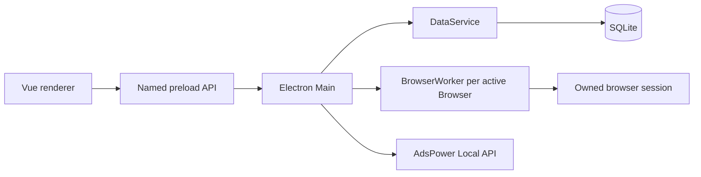

# Browser 2D architecture

Browser 2D separates the interface, task supervision, execution, and persistent data. This keeps task interruption independent of a busy SQLite writer and keeps credentials out of execution processes.

## Package responsibilities

`apps/ui` contains the Browser, Card, and Settings routes. It imports only public contracts and browser-safe utilities. The interface uses Element Plus controls and bordered tables with the established purple theme.

`apps/desktop` contains Electron Main, preload, credentials, updates, platform adapters, and task supervision. It resolves the compiled backend entry points. It does not import backend source or open SQLite.

`apps/backend` builds two runtime roles. DataService opens the database and owns all SQL writes. BrowserWorker hosts an execution thread and imports automation only inside that thread. BrowserWorker cannot reach SQLite or DataService implementation modules. DataService cannot reach Puppeteer or platform adapters.

`packages/contracts` separates browser-safe public DTOs from private host protocols. `packages/amount` provides exact integer-unit conversions. `internal/build-config` and `internal/tsconfig` are build-time configuration only. Root ESLint configuration belongs to its single root consumer.

## Data and credentials

An installed app uses `<userData>/data/app.sqlite`. The product identity in `internal/build-config/release.mjs` sets the application name, installer identity, and executable name. The display name is `Browser 2D`, the executable is `browser-2d`, and the app ID is `io.github.0gnilc.browser2d`.

`BROWSER2D_DATA_DIR` is an explicit userData root override. Its database is always `data/app.sqlite`; its encrypted credential file is `credentials.enc`. Development defaults to `artifacts/dev-data`. Normal startup applies checksummed SQL migrations and never resets existing data. Fresh databases contain no Browser or Card rows.

The domain tables are `browser`, `card`, and `settings`. Internal tables `work_task`, `card_claim`, and `card_operation` coordinate active work and replay protection. `schema_migrations` records the version, file name, checksum, and application time. The migration SQL is copied unchanged into the backend runtime and verified in ASAR.

Card fields remain plaintext. Card numbers are trimmed only at their edges; they are never converted to numbers or normalized. Cards are listed and claimed by creation time and ID in ascending order. Card amount changes use atomic SQL accumulation. A stable ProcessingId and semantic operation key prevent duplicate accumulation and completion counts across retries.

API keys use Electron safeStorage and an encrypted host file. SQLite contains a credential reference. Main resolves the key only for its platform adapter. The key is absent from BrowserWorker arguments, environment, snapshots, and database records.

## Task lifecycle

Each active Browser has one WorkTask and one BrowserWorker. Queued tasks have no execution process. Starting, running, stopping, and unresolved recovery continue to reserve capacity. Main closes its live request gate before asynchronous stop work, so delayed Card messages cannot cross the stop boundary.

Main records ownership before forking and persists a start intent before a platform request. A known session is closed through its exact CDP endpoint. Unknown start results and missing or contradictory ownership remain reserved for recovery. A stored PID is diagnostic information and never grants authority to kill a process.

A stopped unfinished Card returns to pending only after confirmed cleanup. Committed values and operation receipts survive. Receipt-backed input fields remain locked. Task completion increments Browser count once, even if the acknowledgment is lost. Main recovery fences old work and does not automatically resume it.

## Trust boundaries

The renderer receives only named, schema-validated operations. Main accepts calls from its own top-level trusted frame. Other windows and subframes are rejected. The packaged renderer uses the `app://ui` protocol, sandboxing, context isolation, and a content security policy.

Runtime processes receive a minimal environment. Windows retains its absolute `SystemRoot`. Backend workspace contracts and amount utilities are bundled. Native SQLite binaries are unpacked from ASAR. Electron fuses disable RunAsNode, Node options, and command-line inspection, and require loading the application from ASAR.

Boundary checks traverse source imports, manifests, conditional exports, and helpers. Negative fixtures prove the restrictions. Private verification entry points accept fixed operations and dedicated temporary directories; they do not load arbitrary modules or change the public API.

DataService ownership witnesses live under `data/data-service-owners`. Browser execution witnesses live under `data/execution-owners`. A running predecessor must be stopped before a renamed ownership directory is used. The current cutover does not read the retired directory.
