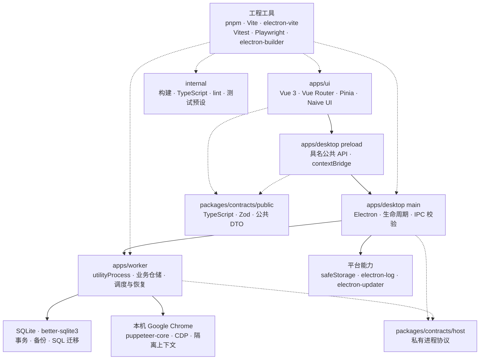

# 架构与技术选型

三个应用共享一个桌面生命周期。`apps/ui` 负责展示和交互，`apps/desktop` 管理窗口与进程，`apps/worker` 执行业务、调度任务并管理浏览器资源。工作进程随桌面关闭，不作为独立后台服务。

## 技术选型图

实线表示运行时调用或资源访问，虚线表示契约及工程配置依赖。此图是静态依赖图，不是状态机。

运行时不导入 `internal`。图中工程工具到应用的连线表示开发、测试及构建输入。

## 目录职责与依赖

| 目录                 | 职责                                             | 允许的依赖                                                             |
| -------------------- | ------------------------------------------------ | ---------------------------------------------------------------------- |
| `apps/ui`            | 五个业务路由、表单、状态及订阅                   | Vue 生态及 `contracts/public`。不访问 Node、SQL、Chrome 或 host 协议   |
| `apps/desktop`       | 主进程、preload、来源校验、凭据、更新与退出协调  | contracts 及 worker 的已编译入口。不导入 worker 业务源码，不打开业务库 |
| `apps/worker`        | 数据迁移、CRUD、调度、取消、恢复和浏览器清理     | contracts、better-sqlite3 和 puppeteer-core。不导入 UI 或 desktop 源码 |
| `packages/contracts` | 公共 DTO、具名 API、结果类型、Zod 校验及私有消息 | 不依赖应用或工程配置。public 与 host 分开导出                          |
| `internal`           | build-config、tsconfig、lint-config、test-utils  | 只供配置和测试使用，不承载业务逻辑                                     |
| `scripts`            | 根命令协调、隔离打包、产物与发布验收             | 调用应用入口和工程配置                                                 |

边界由 [check-boundaries.mjs](../scripts/check-boundaries.mjs) 检查。根包没有生产依赖。worker 的导出入口为 `@browser-2d/worker-runtime/entry`，指向构建后的 `dist/entry.cjs`。

## 工具与构建

TypeScript 统一应用和契约类型。Node 的范围由根清单约束，CI 使用 `.node-version`。pnpm workspace 管理三个目录层级，catalog 固定共享版本，锁文件固定完整依赖树。精确版本只维护在 [package.json](../package.json)、[pnpm-workspace.yaml](../pnpm-workspace.yaml) 和 [pnpm-lock.yaml](../pnpm-lock.yaml)。

worker 使用 Vite 的 Node 构建。desktop 使用 electron-vite 一次构建 main、preload 和来自 `apps/ui` 的 renderer。contracts 随调用方打包，SQL 迁移复制到 worker 的构建目录。UI 没有第二条独立生产构建链。

better-sqlite3 使用锁定版本提供的 Node-API 二进制。打包前检查其预构建策略，不在开发依赖上反复执行 Node 与 Electron ABI rebuild。electron-builder 在隔离目录内生成应用和安装包。正式包使用 ASAR 与 Electron fuses，成品测试在源码仓库之外运行。

## 数据与安全边界

renderer 关闭 Node integration，启用 sandbox 和 context isolation。preload 只暴露具名方法。main 检查调用窗口及 frame，再转发到 worker。自动化网页不加载应用 preload。

worker 是业务 SQLite 的唯一写入者。开发默认使用 `artifacts/dev-data/data.db`。打包应用未设置 `BROWSER2D_DATA_DIR` 时保留 `~/kys/data.db`。Electron userData 是另一条路径，保存 `credentials.enc` 等宿主数据。显式数据目录覆盖同时用于隔离业务数据和 userData。

旧库迁移要求确认旧应用已关闭、取得独占访问并建立验证过的备份。未知结构、更高 schema 版本或迁移校验和不匹配会被拒绝。迁移失败不覆盖新数据，备份可能含旧明文凭据。历史 `day` 与 `year` 字段独立保留，导出兼容格式仍为 `card|month|day|cvv`。

desktop 通过操作系统 safeStorage 保存加密凭据。当前 Chrome 设置不提供 API Key 输入，旧密文引用仅用于兼容。旧明文迁移仍要求持久化加密成功。没有可用的安全存储时，不能用会话内存代替迁移所需的持久化证明。

## 调度与资源归属

`work.start` 返回持久化接纳结果，`work.cancel` 返回持久化取消意图。相同 commandId 和输入返回原结果，改变输入会冲突。响应不确定时查询原命令，避免重复派发。

当前限制为同时执行两台设备、预留四个页面单位。同设备的非终态任务互斥。任务接纳时固定页面需求和非敏感设置，排队不占执行容量，派发一次性预留全部需求。

自有 Chrome 使用应用专属用户目录。借用模式只连接显式配置的本机调试地址，每个任务拥有独立上下文。清理自有会话需确认退出后才能删除用户目录；清理借用会话只删除任务上下文，保留原浏览器及标签页。

未确认的获取或清理继续占用容量和设备。POSIX 自有会话等待进程组消失，Windows 使用单独标记的子进程退出证明，不宣称通用进程族容纳保证。磁盘中的 PID 或进程组标识不授予终止权限。

重启把旧非终态任务标记为 interrupted，核对并清理资源，不自动重放任务。退出先停止接纳，再取消、清理、关库并等待 worker 退出。协作关闭预算为十秒，强制终止和退出确认另有五秒。强制或不确定退出不会报告为干净关闭，也不会允许开发协调器启动替代写入者。

## 安装身份

安装标识由 [release.mjs](../internal/build-config/release.mjs) 的 `identity` 定义，运行时名称由 [main 入口](../apps/desktop/src/main/index.ts)设置。更改身份会影响安装与数据路径，需要单独验收。旧 Squirrel 分发及升级兼容性进展见 [Issue #6](https://github.com/0gnilc/browser-2d/issues/6)。
