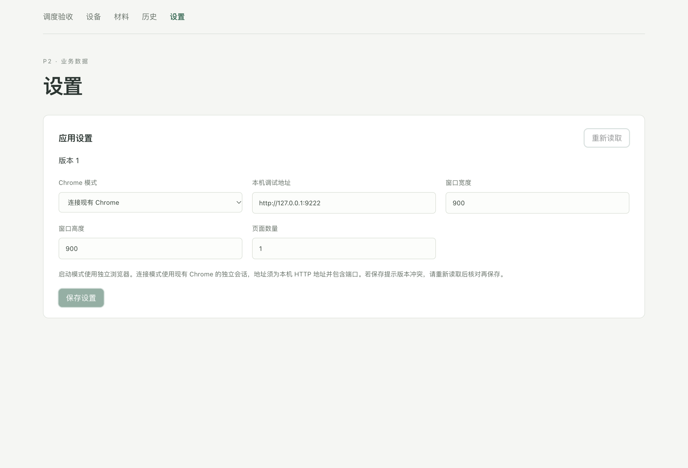

# P4 本机 Chrome 验收

记录日期为 2026-10-31。P4 代码已落地，阶段验收尚未全部通过。按用户决定，暂不处理 GitHub Actions 账户额度问题，不再重跑远端任务，并保留未完成项。P5 未推进。

主要运行实现的矩阵提交为 `9c0464971b7cfc9af70b7d8d7ce8c8168d1ef7d8`。最后补充的成品失败阶段报告只通过本机检查和构建，未启动新的原生矩阵。

## 变更

worker 使用 puppeteer-core 25.16.0 直连 Google Chrome。启动模式使用应用专属临时用户目录；借用模式连接显式配置的本机 HTTP 调试地址，每个任务创建隔离上下文。活动设置已移除 AdsPower 地址、API Key 和凭据操作。

调度限制两台设备、四个任务页面，并在接纳时冻结浏览器、页面数量和视口配置。取消和超时直接中止页面操作的等待。浏览器崩溃使任务失败，恢复只清理旧资源，不重放执行。

自有浏览器关闭前核验启动标记、用户目录、浏览器实例和进程身份。Windows Chrome 独立于 worker 的终止作业启动，恢复时仍需核验身份。已核验的浏览器退出但结果尚未落库时，恢复可通过其 PID 明确不存在的证据释放资源，不依据磁盘 PID 杀进程。

借用会话只清理任务上下文，保留原有标签页、Cookie 和存储。启动结果或上下文身份不确定时，保留清理失败状态和容量，不伪报完成。

004 迁移新增 Chrome 私有配置和资源台账，保留 001 至 003 的校验值、历史业务数据、旧凭据引用和加密文件。已迁移的停用凭据不再阻止 Chrome 启动。旧明文迁移仍先完成加密保存。

全部验证使用临时目录、人工数据和本地页面。未操作真实用户业务数据库，未创建 AdsPower 配置，未执行旧付款或订阅流程。

## 本机验证

环境为 macOS Intel，Node 24.5.0、pnpm 12.16.1、Electron 45.2.0、Google Chrome 156.0.8078.74。另使用 Chrome for Testing 156.0.8078.80 复现并验证 CI 安装目录修正。

| 检查                               | 结果                                        |
| ---------------------------------- | ------------------------------------------- |
| 格式、ESLint、TypeScript、依赖边界 | 通过，边界测试 30 项                        |
| UI 组件                            | 22 项通过                                   |
| SQLite、调度、资源与真实 Chrome    | 57 项通过                                   |
| 旧凭据保存、设置与进程所有权       | 31 项通过                                   |
| Electron 端到端                    | 26 项通过；后续 Chrome 修正另通过针对性复验 |
| 生产构建                           | 通过                                        |
| macOS x64 DMG、ZIP                 | 已生成                                      |
| 脱离源码目录的成品运行             | 连续两次通过                                |

Electron 测试覆盖启动后尚未连接、运行中、上下文创建后尚未保存身份、清理中发生 worker 崩溃，以及启动阶段取消。丢失借用上下文身份时，即使 Chrome 自动移除了上下文，台账仍保留不确定状态。

成品外部观察器每轮记录最多两台并发 Chrome、四个并发隔离任务页面。退出前再观察第三个 Chrome 实例及其两个任务页面，随后关闭桌面应用。全部已记录浏览器 PID 最终不存在，临时目录为空。本机两轮均通过这些断言。

可重跑命令为 `pnpm check`、`pnpm test`、`pnpm test:storage`、`pnpm test:credentials`、`pnpm test:electron`、`pnpm build`、`pnpm dist -- --target=mac-x64` 和 `pnpm verify:package -- --target=mac-x64`。测试和成品验证可通过 `BROWSER2D_CHROME_EXECUTABLE` 指定 Chrome。

本机日志位于 `artifacts/p4-worker.log`、`artifacts/p4-electron.log`、`artifacts/p4-build.log`、`artifacts/p4-package.log`。成品证据和文件校验值位于 `artifacts/mac-x64/`，不提交 Git。

## 最终原生矩阵

[最终矩阵 41168987583](https://github.com/0gnilc/browser-2d/actions/runs/41168987583) 使用上述 `9c04649` 提交。完整状态保存在 `.audit/p4-ci.json`。

| 目标        | 代码与 Electron 测试                                   | 原生分发包生成          | 脱离源码目录的成品验证 |
| ----------- | ------------------------------------------------------ | ----------------------- | ---------------------- |
| macOS Intel | 通过                                                   | DMG、ZIP 通过           | 两轮通过               |
| macOS ARM   | 通过                                                   | DMG、ZIP 通过           | 两轮通过               |
| Windows x64 | 通过，24 项 Electron 用例通过、2 项 POSIX 专用用例跳过 | NSIS 通过               | 失败，待定位和复验     |
| Linux x64   | 通过，26 项 Electron 用例通过                          | AppImage、deb、rpm 通过 | 失败，待定位和复验     |

Windows 和 Linux 失败在成品运行检查，日志只记录 `INITIALIZATION_FAILED` 和 `Packaged process failed`，尚未确认具体断言阶段。不能把分发包生成成功等同于成品通过。Linux 当前提交的 Fedora RPM 安装验证因前置步骤失败而未执行。

补充的验收诊断会保存失败阶段、最终公开快照和外部 Chrome 观察结果。隔离诊断分支为 `codex/p4-package-probe`。[诊断任务 41170041659](https://github.com/0gnilc/browser-2d/actions/runs/41170041659) 尚未执行任何步骤，GitHub 明确返回账户近期付款失败或额度需要提高。用户选择暂不处理，故停止远端重跑。

## 已修复问题与剩余项

已复现并修复浏览器崩溃误报完成、本机显式 80 端口误拒绝、页面创建期间取消等待失效、取消后的迟到 Promise 拒绝、Windows 子进程随 worker 被系统终止，以及已退出自有浏览器的台账恢复问题。CI 还修正了 macOS Chrome 下载目录缺失 `.app` 后缀和 Windows 测试路径分隔符断言。

独立复核没有剩余已复现的代码发现。Model the Domain 用于区分会话归属及持久化状态；Prove It Works 要求观察真实页面和进程，而非仅检查容量字段。详细复核与决策记录在 `.audit/p4-review.md` 和 `.audit/p4.tsv`。

以下验收项保留未完成。

- 读取可执行诊断任务的失败阶段与 Chrome 观察数据，定位 Windows 和 Linux 成品失败原因。
- 修复经证据确认的问题后，重跑同一提交的原生矩阵和 Fedora RPM 安装检查。
- 通过后关闭 [Issue #5](https://github.com/0gnilc/browser-2d/issues/5)。当前保持打开。

分支 `codex/p4-browser` 已推送，未合并 main。内置 GitHub PR 连接器返回 404，未创建 PR，记录保存在 `.audit/p4-pr-connector-error.json`。签名、公证、自动更新和 P5 界面收尾均未推进。
