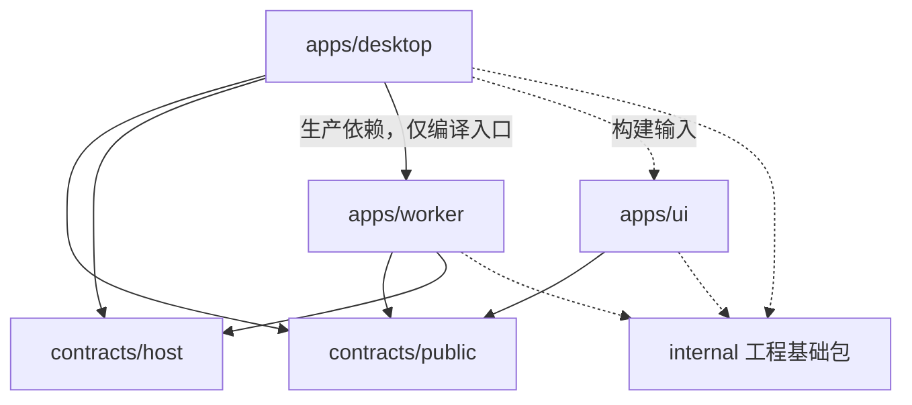
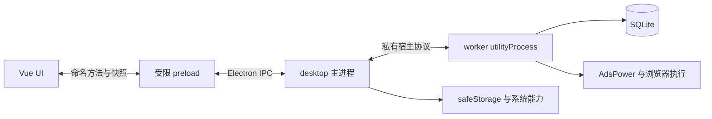
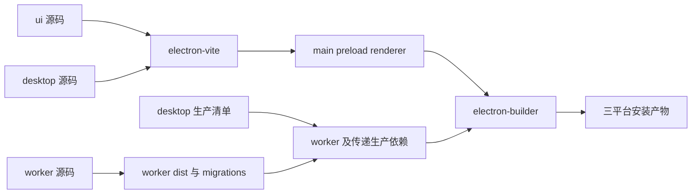

Browser-2d 最终重构方案，2026-10-30。

本文件保留已确认的设计基线。截至 2026-10-31，P0、P1、P2、P3 已实施，实际结果和阶段边界见 [P0/P1 验收](implementation/p0-p1-acceptance.md)、[P2 验收](implementation/p2-acceptance.md)及 [P3 验收](implementation/p3-acceptance.md)。P4 实施期间用户明确将浏览器方案调整为 Google Chrome 与 puppeteer-core，不引入 AdsPower。调整后的边界见 [P4 设计](implementation/p4-design.md)，后续阶段尚未推进。下文“本轮”指原设计轮次，实施状态以验收记录为准。

本方案依据已选技术栈整理应用边界、依赖关系、开发和交付流程。技术选型依据见[调研记录](research/electron-stack-2026-10-30.md)。本轮仅编写方案，没有创建目标目录、修改业务代码、安装依赖或运行应用。下文命令和目录均为实施目标，验收框尚未完成。

产品继续交付为一个 Electron 桌面应用。关闭主业务窗口即停止任务并退出，Windows、macOS、Linux 使用相同语义。工作模块不作为独立常驻服务发布。设备、材料、历史、设置及任务操作保持可核对的业务行为，UI 最终统一到 Naive UI。工程实施阶段由仓库的 GitHub Issues 承接，本轮不创建 Issue 或 PR。

选定的基础技术如下。P0 固定候选精确版本，P1 验证其组合，之后升级通过独立变更完成。

| 能力 | 最终选择 | 初期边界 |
| --- | --- | --- |
| 包管理 | pnpm workspace、workspace 协议、catalog | 一个锁文件，默认隔离布局，无根目录生产依赖 |
| 语言 | TypeScript strict | app、contracts 与测试独立环境配置 |
| UI | Vue 3、Vue Router、Pinia、Naive UI | Pinia 管 UI 状态和只读任务快照 |
| 编译开发 | Vite、electron-vite | 一个桌面 renderer 构建入口，不重复构建 UI |
| 分发更新 | electron-builder、electron-updater | 使用验证过的稳定版本，初期不引入 builder 27 预发布线 |
| 工作运行时 | Electron utilityProcess | 一个宿主，受控异步并发，不默认每设备一个线程 |
| 存储 | SQLite、better-sqlite3、版本化 SQL 迁移 | worker 单点读写，初期不引入 ORM |
| 浏览器控制 | puppeteer-core、现有 AdsPower 协议适配 | 保留业务流程，不因测试工具变化重写生产驱动 |
| 通信 | contextBridge、命名业务方法、Zod | 业务 API 与私有宿主协议分离 |
| 测试 | Vitest、Vue Test Utils、Playwright | 逻辑、组件、真实进程、最终安装包分层验证 |
| 系统能力 | electron-log、Electron safeStorage | desktop 管日志汇聚与凭据系统适配 |
| 规范 | ESLint、Prettier、tsc、vue-tsc | 编译成功不能代替类型和边界检查 |

目录规划如下。每个 workspace 包均为 private，公开入口由 exports 限定。根 workspace 仅包含 apps/*、packages/*、internal/* 三组包。

```text
browser-2d/
├── apps/
│   ├── desktop/
│   │   ├── src/main/               窗口、应用生命周期、进程监督
│   │   ├── src/preload/            浏览器可用的业务 API
│   │   ├── src/bridge/             IPC 校验、请求关联、订阅管理
│   │   ├── src/platform/           凭据、路径、日志、更新
│   │   ├── build/                  图标、签名资源、平台配置
│   │   ├── electron.vite.config.ts
│   │   └── electron-builder.yml
│   ├── ui/
│   │   ├── index.html
│   │   └── src/
│   │       ├── app/                入口、路由、主题
│   │       ├── features/           devices、materials、history、settings
│   │       ├── bridge/             业务 API 注入和显式测试实现
│   │       └── shared/             当前 UI 内共享的组件和组合函数
│   └── worker/
│       ├── src/entry.ts            utilityProcess 启动入口
│       ├── src/host/               请求处理、就绪、退出
│       ├── src/runs/               调度、状态、取消、资源所有权
│       ├── src/storage/            连接、业务仓储、迁移执行
│       ├── src/browser/            AdsPower 与 Puppeteer 适配
│       ├── migrations/             有序 SQL 与校验信息
│       └── tests/                  调度、仓储和驱动测试
├── packages/
│   └── contracts/
│       └── src/
│           ├── public/             UI 可见的业务 DTO、schema、API
│           └── host/               desktop 与 worker 的私有宿主协议
├── internal/
│   ├── tsconfig/                  JSON 类型环境预设
│   ├── lint-config/               规范与导入边界
│   ├── build-config/              显式组合的 Vite 构建预设
│   └── test-utils/                临时目录、进程管理、通用测试辅助
├── scripts/                       根命令编排、产物和依赖检查
├── tests/
│   ├── e2e/                       跨应用桌面场景
│   ├── fixtures/                  脱敏旧库、受控任务输入
│   └── release/                   最终产物、安装和升级检查
├── docs/
├── package.json
├── pnpm-workspace.yaml
└── pnpm-lock.yaml
```

apps 是可启动入口及其专属业务实现。packages 是多个应用共同使用的运行时契约或库。internal 是开发、测试和构建工具。初期 packages 只创建 contracts，不预建通用 domain、database、services、utils 包。设备、材料、任务等业务规则归 worker；如果后续出现第二个真实业务消费者，再评估共享包。

职责与依赖规则如下。

| 单元 | 包名或入口 | 允许依赖 | 禁止事项 |
| --- | --- | --- | --- |
| UI | @browser-2d/ui | contracts/public、Vue 生态、工程包 | Electron、Node、SQLite、worker 实现、contracts/host |
| Desktop | @browser-2d/desktop | contracts/public、contracts/host、worker 的编译入口、桌面依赖 | 导入 worker 业务源码、直接查询业务数据库 |
| Worker | @browser-2d/worker-runtime | contracts、SQLite、Puppeteer、日志依赖 | 导入 UI 或 desktop 实现、访问 BrowserWindow |
| 公共契约 | @browser-2d/contracts/public | Zod | 框架组件、数据库行类型、Electron 对象、IPC 通道和端口 |
| 宿主协议 | @browser-2d/contracts/host | 公共业务 DTO、Zod | 被 UI 引用、作为 renderer 通用 RPC 暴露 |
| 工程基础包 | @browser-2d/*-config、test-utils | 构建或测试工具 | 业务状态、业务仓储、生产运行单例 |

跨应用源码导入被禁止。desktop 对 worker 的编译产物依赖是唯一明确的运行包依赖，不能被扩大成跨应用源码访问。desktop 构建配置选择 ui 的 renderer 根目录属于构建输入声明。生产业务代码不能据此导入其他应用内部文件。包 exports、ESLint 限制导入规则和依赖图检查共同执行这些约束。

源码使用、运行包交付和工程工具是三类不同的依赖，具体关系如下。



依赖清单与生产产物遵守以下规则。

1. root 的 package.json 只声明开发协调工具。根目录不重复声明 SQLite、Puppeteer 等应用生产依赖。
2. apps/worker 的 package.json 是 better-sqlite3、puppeteer-core 和 worker 日志依赖的唯一生产清单。它声明 private，exports 仅暴露 ./entry，指向 dist/entry.cjs。发布文件范围限定为编译产物、迁移文件及必要包元数据，并在成品检查中验证实际范围。
3. apps/desktop 的生产 dependencies 声明 @browser-2d/worker-runtime: workspace:*、electron-updater、实际使用的桌面日志依赖。builder 从该清单收集 worker 及其传递生产依赖。
4. apps/ui 自己声明 Vue、Pinia、Naive UI、Router 等依赖。desktop 对 ui 使用 workspace 开发依赖，renderer 源码和依赖被编译成静态资源，不作为 UI workspace 包安装到成品。
5. contracts 及必要 Zod 代码显式打入各消费方。消费者将 contracts 声明为 workspace 构建依赖，成品不 require 原始 TypeScript 或 contracts 的 workspace 链接。若构建发现残留 external，必须修正构建或明确变更交付契约，不能靠开发机路径补足。
6. internal 仅作为 devDependencies 使用。JSON 与 ESM 配置优先直接消费，避免安装后先构建整套工具链才能运行第一条检查。test-utils 中的 TypeScript 由测试工具消费，不进入生产图。
7. 每个包声明自己直接使用的依赖，catalog 统一版本。依赖安装脚本使用显式允许清单，CI 不依赖交互批准或允许所有脚本。

实际运行关系如下。数据库执行位置始终是工作进程，desktop 的打包清单归属不会改变这一点。



UI 使用以下业务能力。表内参数与结果是契约草案，实际类型由 schema 推导，不在不同应用手写平行接口。

| 业务调用 | 成功的含义 | 后续结果 |
| --- | --- | --- |
| work.start，输入 deviceId、commandId | 运行记录已持久化并被接纳，返回 runId | 快照报告 starting、running 或终态 |
| work.cancel，输入 runId、commandId | 取消意图已持久化 | 清理完成后报告 cancelled，不能把接纳等同于已停止 |
| work.subscribe，输入 listener | 注册订阅并发送一致的初始快照 | 返回 dispose；之后发送带 epoch、revision 的完整快照 |
| work.getCommand，输入 commandId | 查询同一次命令的已知结果 | 用于响应丢失或超时后的确认，不自动创建第二次任务 |
| devices、materials、history、settings 的命名方法 | 对应查询或事务已完成 | 统一 Result 成功值或业务错误码 |

批量操作返回每个设备或记录的结果，部分失败不得被整体成功掩盖。相同 commandId 与相同输入返回已有接纳结果；相同 ID 搭配不同输入返回冲突。超时表示调用方不知道结果，不能据此推断事务未发生。请求、响应和事件均在边界验证，IPC 发送方必须是获准的窗口与 frame。

订阅必须在宿主中一次性建立监听并取初始快照，避免先读后订阅丢事件。epoch 标识工作进程的一次运行，revision 在该 epoch 内递增。旧 revision 被丢弃，epoch 变化时整体替换状态。UI 卸载、窗口销毁和工作进程退出都会释放对应订阅；worker 失联时立即显示不可用并结束等待中的请求。

任务状态为 queued、starting、running、stopping，以及 completed、cancelled、failed、interrupted 四种终态。设备只能有一个活动 run。工作进程持有调度、数据库写入和资源台账，SQLite 事务保证认领与状态更新的边界。设备状态和任务状态分别建模，UI 不根据按钮状态自行推断任务已完成。

工作宿主使用设备并发上限和页面并发上限控制异步执行。取消信号传入等待、重试和浏览器操作，不用无限重试维持任务。初期不默认线程池；只有明确需要单执行单元强制终止或 CPU 工作时才增加隔离执行器。现有每设备线程改为异步执行的行为差异在 P3 和 P4 验证。

凭据由 desktop 的系统适配层负责加密和解密，worker 业务配置只持有引用。desktop 在授权后取得本次任务需要的凭据快照，通过私有启动上下文交给 worker。公共响应 DTO、订阅和日志不含凭据。运行中的任务使用固定配置版本，配置修改默认对后续任务生效。初期不增加反向通用 RPC。Linux 无可用安全存储时允许明确的会话内凭据模式，不静默持久化明文。引用清理只能缩短秘密在内存中的生命周期，不能承诺安全擦除。

密文和引用索引由 desktop/platform 的凭据存储独立持有，位于 app.getPath('userData') 下的 credentials.enc，采用原子替换写入。desktop 按 secretRef 读取并解密，不访问业务数据库。配置更新先保存新密文，再由 worker 事务切换 secretRef；切换失败保持原引用，未使用的新引用可回收。旧库中的明文凭据迁移必须在新存储确认可读后删除，失败时不启用任务。P2 验证保存、重启读取、失败恢复和新凭据不以明文落盘。

凭据录入是公共 API 的只写敏感输入例外。UI 可把输入提交给 desktop，API 不提供读取明文的公共方法；响应 DTO、订阅、错误详情和日志仍不得包含凭据。worker 只在私有执行上下文中得到任务需要的明文快照。

关闭窗口、应用退出、更新安装和开发热重启使用同一关闭协调器。macOS 不额外执行隐藏到后台的分支。关闭流程固定为停止接纳、持久化取消、取消执行、清理本应用拥有的外部资源、提交状态、关闭数据库、等待 worker 退出、退出 Electron。建议的初始策略预算为协作关闭 10 秒、强制终止及退出确认 5 秒。这是待验证的行为上限，不是测量结果。

强制终止、worker 崩溃或宿主失联时，不能报告干净完成。所有未终结状态，包括 queued、starting 和 stopping，均在恢复时判定为 interrupted。不得自动重放可能产生外部副作用的操作。新宿主在确认旧进程结束后才能接管数据库。旧进程退出不确定时，保持不可用并报告原因，不启动第二个写入者。

资源台账记录任务拥有的 AdsPower profile、会话和待清理义务。尽可能在创建外部资源前持久化意图，并覆盖创建成功但记录返回 ID 前崩溃的窗口。恢复时用已知 profile 与外部状态进行核对。只清理本应用拥有的会话，不误关用户原有会话。杀死 utilityProcess 不等于外部浏览器已停止；清理失败必须可见并阻止冲突任务。desktop 不为清理直接读取业务数据库，恢复由新的 worker 完成。

存储迁移第一轮保留现有配置路径 ~/kys/data.db，不把驱动替换和目录迁移放在同一步。新建开发和测试数据使用独立目录。迁移前确认旧应用已关闭并取得独占迁移访问，新应用的单实例锁不能代替对旧程序的检查。

迁移使用一致性 SQLite 备份，包含 WAL 中的已提交内容，并验证备份可读及完整性。SQL 文件有顺序、版本和校验信息；可事务执行的结构变更在事务内完成，迁移记录与变更一同提交。失败不得记录为已迁移，已执行版本的 SQL 不允许被静默改写。遇到更高 schema 版本时拒绝写入。恢复保留原备份，新版本产生数据后不自动用旧备份覆盖，降级需要明确的恢复操作。

生产构建只有以下一条链路。

| 产物 | 生产者 | 输出与使用方式 |
| --- | --- | --- |
| 工作入口 | worker 的 Vite Node 构建 | apps/worker/dist/entry.cjs；业务源码及 contracts 被打包，原生和指定生产依赖 external |
| 迁移文件 | worker build | apps/worker/dist/migrations/*.sql；相对编译入口读取，不使用 cwd |
| 主进程 | desktop electron-vite | apps/desktop/dist/main/index.cjs |
| preload | desktop electron-vite | apps/desktop/dist/preload/index.cjs；单个 sandbox 兼容 bundle |
| renderer | 同一次 desktop electron-vite | 输入 apps/ui/index.html，输出 apps/desktop/dist/renderer；使用 ui 自己的依赖 |
| 安装产物 | electron-builder | 从 apps/desktop 作为应用根，输出 release/<platform>-<arch> |



root build 先构建 worker，再调用 desktop electron-vite。不先单独生成 UI dist 再由 electron-vite 重建一遍。独立 UI 浏览器预览是开发能力，不构成第二条生产构建链。构建配置显式声明 ui 根目录、资源基址和输出目录，别名仅在所属应用内有效。

BrowserWindow 显式设置 sandbox: true、contextIsolation: true、nodeIntegration: false。生产 UI 通过受限 app:// 本地协议访问 renderer 资源，开发仅允许指定 dev server 来源。协议处理器限制在 renderer 资源目录内，IPC 校验获准窗口及 frame，自动化网站不获得应用 preload。P1 在真实窗口验证没有 Node 访问能力，并拒绝不匹配来源的 IPC。

desktop 用 Node 模块解析获得 @browser-2d/worker-runtime/entry 的绝对路径，再交给 utilityProcess.fork，不 import 或执行 worker 业务代码。builder 的 pnpm collector 负责把 workspace 生产依赖转为成品中的依赖实体。成品不得包含指向仓库或 pnpm store 的外部链接，也不得依赖用户安装 Node、pnpm 或另一个 Chromium。

JS 默认保留 ASAR 保护，按已证明的加载需求解包 .node 和必要的邻接资源。初期不整体解包 node_modules，不手动把任意 ASAR 路径改写成 unpacked 路径。P1 必须验证编译入口、SQL 文件和原生模块在真实安装目录中可加载。若失败，先修改并记录产物布局设计，通过同一验收后再迁移业务，不加入隐式路径复制补丁。

工程的原生依赖验证分为 host Node 和目标 Electron 两种环境。默认 dev 使用 Electron 原生依赖环境；纯逻辑测试不依赖原生模块，原生仓储测试与 test:electron 放在单独安装目录或 CI job。缓存键包含锁文件、运行时版本、ABI、OS、架构，不在同一 node_modules 中反复切换 Node 与 Electron rebuild。平台打包在独立构建目录进行，不覆盖本机开发依赖。

根命令拟定如下。脚本由 scripts 编排，internal 提供配置和辅助能力。签名、上传和发布不作为普通 build 的副作用。

| 命令 | 契约 |
| --- | --- |
| pnpm install --frozen-lockfile | 安装锁定依赖；CI 使用已提交的依赖构建允许清单 |
| pnpm dev | 首次构建 worker，启动 electron-vite 的 UI HMR 和 desktop；工作入口就绪后开放任务操作 |
| pnpm dev:ui | 仅预览界面，使用明确的 fixture bridge，不伪装成可执行真实任务 |
| pnpm dev:worker | 用最小 Electron 宿主驱动真实 utilityProcess 与测试数据，不承诺独立 Node 服务 |
| pnpm check | 格式、lint、依赖方向、tsc、vue-tsc；任一失败则返回非零 |
| pnpm test | 纯逻辑、契约、Vue 组件测试，不隐式启动生产浏览器或访问用户数据 |
| pnpm test:storage | 在隔离的 Node 原生依赖环境检查仓储、事务、迁移和旧库 fixture |
| pnpm test:electron | 在 Electron 环境检查真实 IPC、utilityProcess、数据库加载和关闭协议 |
| pnpm test:e2e | 使用独立的可调试桌面测试构建，执行 Playwright 关键交互 |
| pnpm build | worker 后接 desktop 的统一构建，并检查入口、迁移和资源是否齐全 |
| pnpm package -- --target=<目标> | 在目标隔离环境生成可运行应用目录，不上传 |
| pnpm dist -- --target=<目标> | 从目标构建生成安装器和更新元数据；开发预览与正式签名模式明确区分 |
| pnpm verify:package -- --target=<目标> | 验证指定真实产物，包含安装、运行、数据、任务关闭和文件布局 |
| pnpm verify | 执行 check、test、storage、Electron 集成、build 与 E2E 的本地验证集合 |
| pnpm release:verify | 检查最终签名产物、元数据、校验值和各平台验收证据 |
| pnpm release | 仅发布已验证的指定产物；不重新构建，不隐式升级版本 |

main、preload、worker、contracts 或工程配置变化时，开发协调器等待新构建成功，再执行统一关闭协议并重启应用。UI 模板和样式变化可用 HMR。关闭失败不得与新宿主重叠启动，构建失败保持当前可用进程并展示错误。普通开发采用独立数据目录和可控任务目标。

测试要求以用户可观察行为为准，不以内部函数数量作为覆盖目标。

| 测试层 | 关键场景 | 验收证据 |
| --- | --- | --- |
| 契约与状态 | 错误输入、重复命令、冲突 ID、接纳与完成、合法状态转换 | 可重复的通过记录及失败案例断言 |
| 存储 | 旧 schema、WAL 备份、迁移失败、原子认领、重复结果、较新 schema 拒绝 | 临时库状态、完整性结果和迁移报告 |
| 调度 | 并发上限、设备互斥、取消、超时、worker 崩溃、宿主丢失 | 确定性 fixture、状态快照、进程退出证据 |
| 浏览器适配 | 连接、页面并发、超时、取消、拥有与借用会话清理 | 受控 AdsPower/浏览器场景及资源状态 |
| Vue 组件 | 表单校验、导入、分页、过滤、错误呈现、卸载清理 | VTU 测试结果 |
| 桌面集成 | UI→preload→main→worker→DB、重启读取、拒绝未授权 sender | 真实 Electron 测试日志 |
| E2E | 原有关键业务路径、重复进出页面无订阅累积、离线与恢复 | Playwright 报告、失败截图和 trace |
| 最终成品 | 仓库外安装、原生加载、工作进程、升级、卸载、退出无残留执行 | 对应产物哈希、安装记录、日志及必要截图 |

生产自动化测试使用受控目标和脱敏 fixture。模拟适配器用于确定性故障注入，真实适配器另有受控集成验证，两者不能互相替代。关闭验收既观察进程，也观察任务拥有的外部资源；无法确认的清理义务不得被记为通过。

Playwright 测试构建允许其必需的 inspector 能力，并与正式构建明确区分。正式包关闭非必要的 inspector 和 RunAsNode，保留所需完整性保护。最终成品另用常规系统启动和受控操作验收，不能为了让 Playwright 启动而放宽发布包。签名和公证后的文件必须再次验收。[Playwright Electron 限制](https://playwright.dev/docs/api/class-electron)、[Electron fuses](https://www.electronjs.org/docs/latest/tutorial/fuses)

首期平台与 CPU 的规划默认值如下。用户已确定三平台；以下 CPU、OS 基线是本方案选定的首轮验收范围，尚未实测。实施 P0 记录实际镜像和版本，新增架构必须新增相同门槛，不能只凭交叉编译宣称支持。

| 目标标识 | 首轮验收环境 | 安装产物 | 更新策略 |
| --- | --- | --- | --- |
| win-x64 | Windows 11 x64 | Authenticode 签名 NSIS | electron-updater |
| mac-arm64 | macOS 14 或之后的受支持版本，Apple Silicon | Developer ID 签名并公证的 DMG、更新 ZIP | electron-updater |
| mac-x64 | 受支持的 Intel macOS，最低基线 macOS 14 | 同上，单独构建与验收 | electron-updater |
| linux-x64 | Ubuntu 24.04 LTS 验证 AppImage/DEB，Fedora 44 验证 RPM | AppImage、DEB、RPM | AppImage 应用更新，DEB/RPM 初期使用包管理渠道 |

macOS 必须分别覆盖 Intel 与 Apple Silicon，不能用一个架构的成功代替另一个。Linux 明确记录构建发行版、glibc 基线、显示服务器、keyring 和 AppImage runtime；对 Ubuntu/Fedora 验收通过不意味着支持所有 Linux。签名证书、Apple 身份和发布权限仅在正式发布阶段成为必需条件，未具备时可以完成早期未签名技术验证，但不能把正式发布标记为完成。

发布流程为锁定提交与工具链、基础检查和测试、目标平台构建、原生模块验证、应用 fuses、签名及 macOS 公证、生成最终安装器与更新元数据、验证最终产物、记录校验值，最后发布同一批文件。任何签名后改写或重新构建都使原有产物验收失效。macOS ZIP、安装器、版本和更新元数据必须相互对应。[builder 发布与更新](https://www.electron.build/v26/docs/features/auto-update/)

P0 确认是否已经存在安装用户，并冻结 appId、产品标识与数据路径。若已发布 Squirrel 安装器，Windows NSIS 迁移单独验证快捷方式、安装注册、旧版本卸载与数据保留。更新安装同样遵守先停任务后退出的生命周期，不能在有活动任务时直接替换程序。

更新分发默认采用 electron-updater 的 generic HTTPS feed，区分 stable 与测试频道。下载地址由发布环境配置，客户端不携带源码仓库或上传凭据。P6 在受控 feed 上验证 N→N+1 更新、下载失败与版本检查；实际存储和域名可以替换，产物及元数据格式保持一致。本轮不配置线上渠道或上传文件。

CI 从第一阶段开始建立，不留到最后补建。PR 基础 job 执行锁定安装、check、test、storage、build。平台 job 执行 Electron 集成和安装包冒烟，release candidate 执行完整四个目标矩阵与签名后的验收。暂缺 runner 或签名证据的目标显示未通过，不能用另一平台结果替代。

实施按 P0→P1→P2→P3→P4→P5→P6 推进。每阶段有可检查的产物与退出条件。阶段内可按表中的垂直切片拆 PR，下一阶段不得建立在未通过的依赖阶段上。所有命令结果都绑定提交号、锁文件和相关运行环境，截图或日志仅作为对应行为的证据。

| 阶段 | 实施范围 | 必须完成的验收 | 退出证据 |
| --- | --- | --- | --- |
| P0 冻结基线 | 核对当前页面、CRUD、导入导出、任务语义、旧库结构、安装身份和资源所有权；固定候选版本与目标矩阵 | 所有现有用户流程都有预期；已知缺陷与必须保持的行为分开记录；旧库使用脱敏 fixture；明确未能运行的基线 | 行为清单、fixture、版本及平台清单、风险记录 |
| P1 最小桌面闭环 | pnpm workspace、internal 预设、contracts 骨架、三应用入口、builder；只执行合成任务与临时库 | 四个目标均可从干净安装构建；仓库外启动；UI 调用穿过 preload/main 到 worker；renderer 隔离与 IPC 来源限制通过；SQLite 写入重启可读；取消和关闭通过；无外部链接或原始 TS 运行依赖 | 未签名技术验证包、入口与依赖检查、真实运行日志、任务结束与进程退出证据 |
| P2 存储与业务契约 | 更换 better-sqlite3；迁移和备份；设备→材料→历史→设置依次接入 worker；凭据边界 | 每个切片完成调用→事务→刷新→重启读取；旧库兼容、WAL 备份、失败回滚、原子认领、较新 schema 拒绝通过；凭据密文存储与重启引用通过；main 无业务 DB 访问 | 仓储与迁移测试、Electron CRUD 集成、备份完整性与凭据迁移报告 |
| P3 调度与恢复 | 用可控驱动实现持久化接纳、并发限制、取消、资源台账、快照、异常恢复 | 同设备不重复运行；重复 commandId 不重复接纳；全部非终态恢复为 interrupted；关闭预算、宿主丢失和旧进程退出确认通过；无自动重放 | 确定性调度场景、故障注入、进程和资源状态报告 |
| P4 真实浏览器适配 | 接入 puppeteer-core 与 AdsPower，保持原有业务流程；验证异步调度替代线程的影响 | 受控环境验证启动、页面并发、失败隔离、超时取消、拥有/借用会话清理；清理失败有明确状态；不依赖真实用户账户或实际业务副作用 | 适配器集成记录、关闭及崩溃场景、与 P0 行为清单的对照 |
| P5 UI 与开发体验 | 各路由迁移到 TS、Pinia、Naive UI；连接唯一公共 API；完整开发重启流程 | 表单、导入、分页、筛选、历史、设置与任务操作满足行为清单；组件与 E2E 通过；订阅不累积；UI 仅使用公共 DTO；HMR 和工作模块重启可验证 | 路由验收表、VTU/Playwright 报告、关键界面截图 |
| P6 正式分发与收尾 | 生产 fuses、签名、公证、更新渠道、安装器迁移、清理旧链路和开发文档 | 四个目标最终产物完成安装、升级、更新、数据保留、卸载和退出验收；应用不依赖源码仓库；旧 Forge/npm 锁文件/Element Plus/旧 sqlite3/旧入口已退出使用；CI 与根命令一致 | 最终产物、哈希、签名/公证记录、更新 N→N+1 记录、发布验收矩阵 |

P2 的每个业务切片迁移其全部调用方，不并存两套可继续扩展的公共 API。P5 按路由替换组件，不同时改变浏览器驱动或数据库语义。过渡期旧代码只作为基线，不能与新工作宿主同时写入同一数据库。对应调用方迁移完成后即删除废弃路径，P6 检查是否仍有残留，不把全部删除工作积压到最后。

整体完成条件如下，全部满足后才可称为基础架构重构完成。

- [ ] apps、packages、internal 的边界检查通过，没有循环依赖或跨应用源码导入。
- [ ] 一个锁文件和包依赖图能解释全部生产依赖，worker 原生依赖未在根目录手工复制。
- [ ] 干净检出可完成规定命令，UI 开发、工作模块重启和完整桌面开发均可使用。
- [ ] 旧数据可备份、迁移和恢复，worker 是唯一业务数据库访问者。
- [ ] 任务接纳、取消、完成、中断和清理状态有一致语义，关闭桌面后不再继续执行任务。
- [ ] 所有原有用户流程有验收结果，目标 UI 已完成 Naive UI 迁移。
- [ ] Windows、macOS 两种架构和 Linux 的最终安装产物及更新流程通过对应验收。
- [ ] 正式成品的安全配置、签名、公证与验收产物一致，发布使用同一份已验证文件。
- [ ] 旧构建、数据库驱动、入口和重复依赖已移除，README、运行说明和故障恢复说明与实际命令一致。

本方案综合了三个独立候选及一次独立设计评审。采用私有 worker 运行包作为产物边界，保留原数据路径，使用单一 renderer 构建链。凭据采用私有启动上下文，存储按业务垂直切片验收。未采用整体解包 node_modules、手工复制生产依赖清单、迁移驱动时同时搬迁数据库或提前引入反向通用 RPC 的方案。

Laziness Protocol 决定初期只建立必要共享包。Boundary Discipline 决定公共契约与宿主协议的区分。Separate Before Serializing Shared State 决定 worker 的数据所有权。Sequence Work into Verifiable Units 决定阶段顺序，Prove It Works 决定以真实运行及最终安装产物验收。当前完成的是方案一致性核查，以上实现和运行验收尚未执行。
