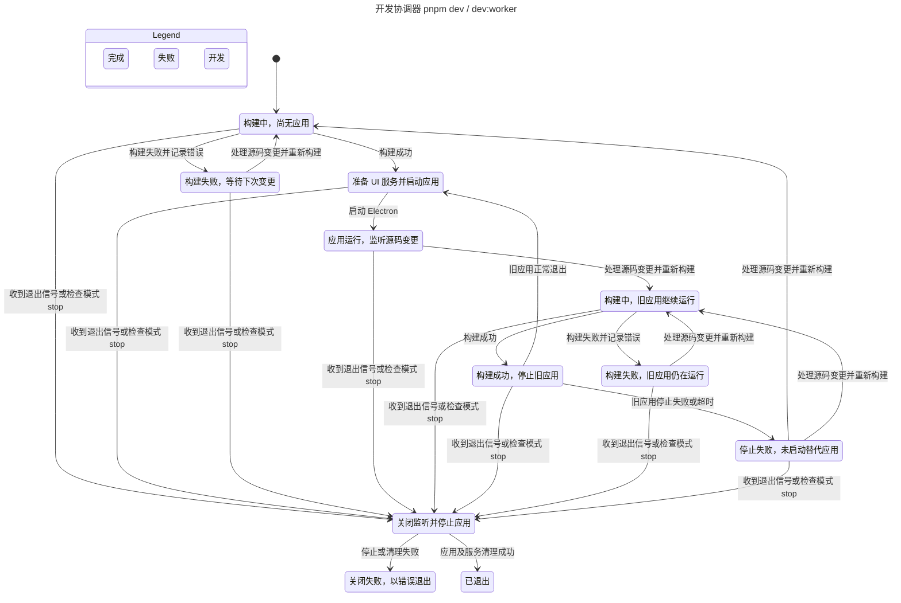
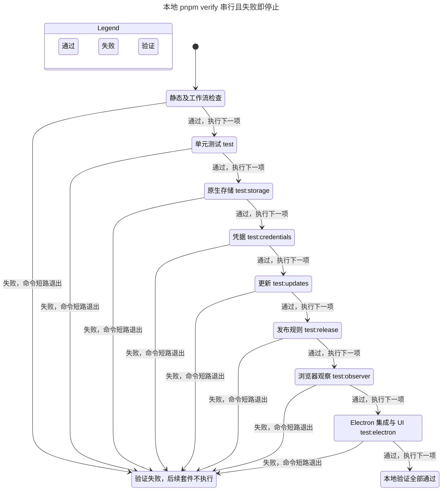
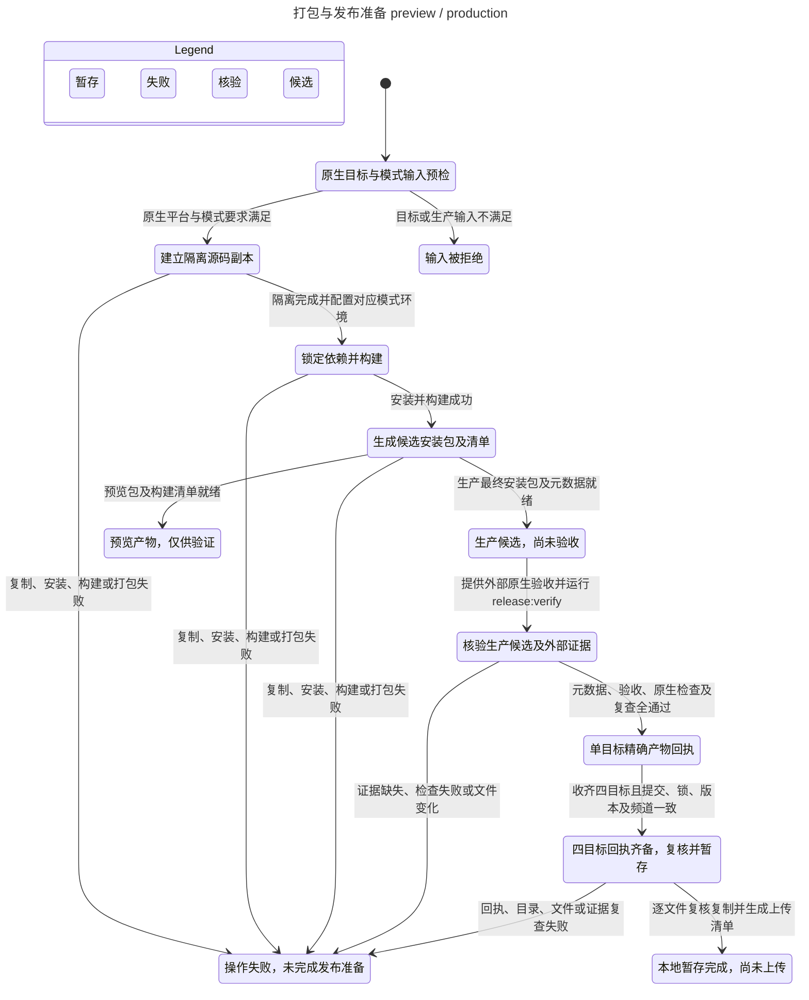

# 开发、测试与打包流程

技术依赖见[技术选型图](architecture.md#技术选型图)。以下 Mermaid 图按当前脚本描述开发、测试和打包流程，不替代应用测试、安装验收或正式发布证明。

## 开发流程

对应 [scripts/dev.mjs](../scripts/dev.mjs) 的 `pnpm dev` 和 `pnpm dev:worker`。先构建 worker，再构建 desktop。构建及配置加载成功后才停止旧应用。停止失败时不启动替代进程。

Vue 模板和样式的 HMR 保持原 worker，不经过整应用重启。`dev:worker` 不创建 UI 服务，`dev:ui` 是独立的浏览器预览入口。首次启动前先完成依赖安装，三个入口的操作步骤见[开发指南](development.md)。

图省略重复文件事件和防抖等内部步骤，保留构建、重启与退出的主要失败分支。具体异常和并发处理以开发脚本为准。

## 测试流程

对应根 [package.json](../package.json) 的 `pnpm verify`，各组命令按顺序运行。任一命令失败即停止，不执行后续命令。

`check` 包含格式、lint、类型和边界检查。`test:electron` 先构建再运行真实 Electron 测试。图将每组命令作为一次成功或失败结果，不表达测试覆盖率及内部断言。

[CI 工作流](../.github/workflows/ci.yml)保留完整原生矩阵，另验收安装包和实际交付格式。`Native acceptance` 只有在整个矩阵成功时通过。PR、main push 和手动运行均使用相同范围，独立分支 push 不重复触发。文档改动也运行完整 CI，避免跳过整个工作流后缺少检查结果。具体步骤及 runner 只维护在 YAML 中。

## 打包与发布校验流程

对应 [package.mjs](../scripts/package.mjs)、[release-verify.mjs](../scripts/release-verify.mjs) 和 [release-prepare.mjs](../scripts/release-prepare.mjs)。图覆盖 `dist` 到发布准备的路径。`package` 仅生成可运行目录，不满足正式候选要求。

图中的候选生成、原生验收和四目标暂存是不同操作。预览包不能获得正式验收回执，当前发布命令不上传文件。操作步骤见[发布工程](release.md)。
